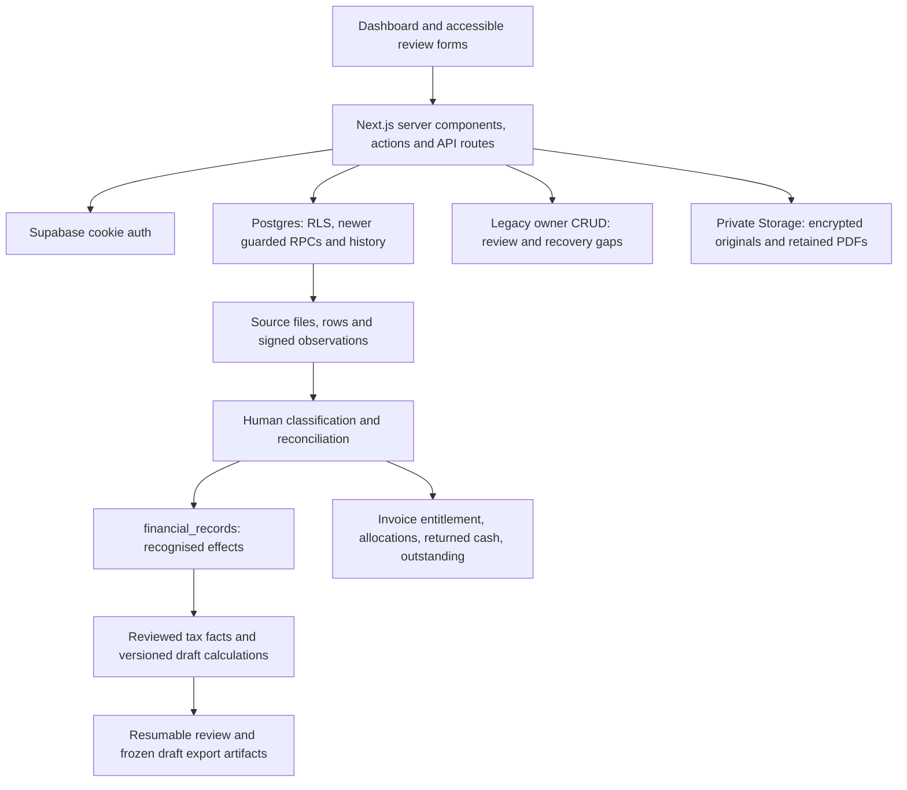

# VibeCount vNext — Milestone 0 audit and implementation plan

18 October 2026. **Plan for review. This audit changes this document only; it does not implement application code, change dependencies or create/apply migrations.**

This audit reads `handover2.md` against the actual working tree, including existing uncommitted work. The refreshed inspection includes the already-present cash-plan, annual rollover, deadline review, shared refunds, complete import reversal, FX evidence/native boundaries, native-only balance view, currency-aware reporting and reconciliation export, partial account export, authoritative operational review with per-request AI consent, and versioned tax/filing/finance invoice coverage. It creates no application work. It replaces the earlier inventory and historical failing-check statements in this document. Architecture and schema were independently inspected by read-only research agents. The inventory below describes this refreshed M0 inspection: 61 migrations, including 36 untracked additions, 39 modified tracked files and 255 untracked status entries (412 untracked files). Earlier implementation checkpoints in `implementation-progress.md` are historical and do not override the current source inventory. Neither local source nor test success establishes deployment. Earlier delivery checkpoints remain historical, with their original scope and test counts.

## Recommendation and current state

Extend the existing Next.js/Supabase application. Retain `financial_records` as the recognised accounting model, supplied by immutable source observations and human decisions. Reuse the existing invoice, reconciliation, merchant-memory, tax snapshot and draft-pack infrastructure. A replacement framework or second accounting ledger is unjustified.

| Boundary | Observed state | Implication |
| --- | --- | --- |
| Git baseline | Branch `claude/vibecount-ai-agents`, HEAD `5cb31c6`; committed package specifies Next 16.2.6 | This differs from the Phase 3 branch named in `AGENTS.md` |
| Working tree | Next 16.4.2, React 19.2.4, TypeScript, Tailwind 4; extensive modified/untracked code | Current local capabilities exceed the committed baseline |
| Migrations | 61 files: 25 tracked and 36 untracked October additions | Review/version existing additions before proposing replacement tables; deployed state is unknown |
| Phase boundary | Committed `/api/mcp/**`, `lib/mcp/**`, agent settings and agent-session migration coexist with instructions parking Phase 4 | Preserve this work and isolate the intended release; do not extend it incidentally |
| Hosted systems | Not queried or changed by this audit; no local `supabase/config.toml` found | Auth, PostgREST, Storage, linked migrations, environment and recovery need a separate release rehearsal |

The checkout already contains substantial M1–M5 implementation. Local presence and green tests do not certify a complete historic Self Assessment workflow or independent tax review. M6 also has local reviewed cash-plan persistence, forecasts, exports and annual merchant-rule rollover. Reviewed in-app deadline plans and acknowledgements also exist locally; they do not send external reminders or establish that tax was paid or filed. Ongoing source integration and broader scenarios remain unfinished.

## Architecture and reusable components

This describes local implementation, not a verified deployed topology. Existing external integrations include Supabase, Resend, PostHog and AI/voice provider calls; no new provider is required for the first slice.

| Area | Evidence to reuse | Assessment and remaining work |
| --- | --- | --- |
| Auth/server boundary | `proxy.ts`, `lib/supabase/{server,middleware,admin}.ts`, dashboard layout | Cookie refresh and `auth.getUser()` exist. Privileged service clients bypass RLS and require explicit owner checks |
| Accessible UI | `DashboardShell`, `AccessibilityProvider`, `ExplainTerm`, `PlainLanguageNote`, `ReadAloudButton` | Reuse semantic controls, stable test IDs, figures/words and confirmation reset; prove full authenticated keyboard journeys |
| Commercial workflow | `app/dashboard/invoices`, quotes/proposals/contracts/projects, repeating drafts, PDF modules | Preserve working invoice creation, finalisation review, branding and history; no sending is needed for M0 or the import slice |
| Money and periods | `lib/money.ts`, `lib/invoices/money.ts`, `lib/records/{tax-periods,accounting-effect}.ts` | Exact checked pence, words, UK year boundaries and signed refunds already exist; audit legacy floating-point boundaries rather than replacing all money code |
| Source import | `app/dashboard/imports`, `source-csv.ts`, `source-store.ts`, `source-persistence.ts`, `source-crypto.ts` | Mapped CSV preview, account labels, encrypted originals/rows, hashes, dedupe, human classification and reversal exist locally. GBP only; certify representative Starling/Nationwide/Amex formats |
| Evidence and recovery | `document-intake.ts`, `document-store.ts`, `evidence-keyring.ts`, `recovery-store.ts`, recovery page | Bounded PDF/image/ZIP preservation and retained-key recovery exist. Opaque storage is not readable source review, OCR or verified employment/invoice extraction |
| Reconciliation | Reconciliation pages; `allocations.ts`, `transfers.ts`, `refunds.ts`, `duplicates.ts`, `match-proposals.ts`, `match-data.ts` | Partial/many-to-many GBP allocations, explained suggestions, transfers/card repayments, refunds and duplicates exist. Shared-refund approval, safe original selection, complete-effect reporting and full-import reversal now exist locally. FX financial workflows and hosted acceptance remain gaps; independent-connection assignment/reversal race tests already exist locally |
| FX preparation | `lib/fx/{currency,settlement,document-facts,document-facts-store}.ts`, migrations `18120000`–`18160000`, `/dashboard/reconciliation/fx/evidence` | Exact currency scales/rational arithmetic, detached settlement preview and immutable provisional/verified/withdrawn document facts exist. Human review now includes local hash matching, original-read attestation and stale-safe capture; native origin guards contain commercial actions. Canonical external/foreign invoice capture and guarded FX financial settlement remain absent; GBP/native-only constraints remain |
| Invoice economics | `economics.ts`, `balances.ts`, credits/refund assignments and invoice history | Reuse immutable PDF/economic revisions, credit entitlement and returned-cash separation; matching must add zero extra income |
| Merchant memory | Review/memory and rollover pages, `merchant-memory.ts`, `merchant-rollover.ts`, merchant exports | Account/year/date scope, precedence, overrides, batch review, evidence, undo, materiality queue and reviewed adjacent-year rollover exist. Rollover defaults disabled, creates a separate family and approves no transactions; verify full hosted journeys |
| Tax facts | Tax-prep/facts page, `lib/tax/facts.ts`, profile/fact revisions | Typed PAYE, termination, pension, vehicle, payment and other facts exist. Unknown, provisional, excluded and verified are distinct; verification is human source review |
| Currency coverage | `lib/invoices/currency-coverage.ts`, `app/dashboard/InvoiceCurrencyCoverage.tsx`, `lib/finance/coverage.ts` | Reuse strict owned projection, complete counts, per-currency read-back and unsupported-state gates. Original invoice units are not cash, taxable income or GBP valuations |
| Tax calculations | Tax-prep/calculation page; `calculation.ts`, `rules.ts`, `scope.ts`, `snapshot.ts` | Deterministic 2025/26 rules, reviewed scope, traces and immutable capture exist. Unsupported profiles/treatments and unsupported invoice coverage withhold affected figures. Current input v2 preserves retained v1 replay. Independent tax review is pending |
| Draft filing pack | Tax-prep/filing-pack page; `filing-pack.ts`, `filing-server.ts`, `form-mapping.ts` | Ten resumable review steps and seven hashed outputs exist locally. Current coverage-aware bundles are v3; all step digests bind invoice coverage. Annual mapping is engineering checked, not independently certified; large-artifact and unsupported-branch limits remain |
| Operational review | `lib/records/financial-review.ts`, `/dashboard/review`, `/api/review/suggest`, migration `18180000` | Authoritative signed GBP quarter totals, complete counts, bounded samples, unresolved-source coverage and actual native outstanding exist. AI requires explicit consent for one current source token and receives generated labels rather than user text. Quarterly capture is a latest-check upsert, not immutable history or tax completeness certification |
| Exports and operations | `export-pages.ts`, `consistent-reconciliation.ts`, CSV exporters, secret scanner, `.github/workflows/ci.yml` | Reuse complete keyset paging, consistency stamps and formula defence. Current reconciliation V3 separates original invoice units from GBP cash; retained V2 bytes remain compatible. `vibecount.partial-account/2` is an allowlisted, versioned account projection with completeness checks, not a restorable backup. Direct downloads fail closed above 4 MB. Export manifests are not a full database/object/key backup |
| Ongoing Finance OS | `/dashboard/finance`, `lib/finance/{plan,snapshot,server}.ts`, `/api/finance/export` | Reviewed dated balances, all-year earmarks/obligations, 2026/27 forecasts, drawings/targets and immutable replayable snapshots exist. Balances are reviewed transcriptions, not bank-verified. Current context/input/result v2 retain the exact manual GBP scenario while withholding effective free cash/drawings for unsupported invoice coverage; legacy v1 replay remains. Deadlines consume explicit obligations, not forecast tax figures. `/dashboard/finance/deadlines` already has reviewed, persisted year-specific plans, history and safe export; external delivery, broader scenarios and ongoing source integration remain |

Legacy staging and legacy tax-prep exports coexist with the newer provenance/snapshot paths. Label their differing guarantees and consolidate only after compatibility tests. Do not invent missing historical source hashes.

## Existing data model and proposed changes

`financial_records.amount` is a non-negative `numeric(12,2)` magnitude. Its record type and `effect_sign` describe recognised income/expense and refund reductions. `bank_transactions.signed_amount_pence` describes a source observation. Keep these roles distinct and convert exactly at their boundary.

The handover's logical nouns already map to the following local schema; these are **existing migrations**, not proposed SQL created by this audit:

| Local migration suffix | Existing entities |
| --- | --- |
| `17100000` | Atomic reviewed legacy import confirmation |
| `17110000` | `financial_accounts`, source upload attempts/files/rows, `bank_transactions`, classification decisions and import events |
| `17120000` | Evidence documents, intake batches/items, upload attempts and registration events |
| `17130000`–`17140000` | Invoice settlement allocations/reversals and transfer pairs |
| `17150000`–`17180000` | Invoice revisions, reviewed refunds, credit notes and returned-cash assignments |
| `17190000`–`17210000` | Duplicate verdicts, evidence recovery/key provenance, merchant rules/versions/applications/undo |
| `17220000` | Tax profiles/revisions, fact families/revisions/sources and section attestations |
| `17230000` | Calculation scopes, `tax_rulesets`, immutable `tax_calculations` |
| `18000000` | Filing step reviews, annual form mappings, `filing_packs` and export links |
| `18010000` | Category ownership/type guards, immutable category identity and owner-safe legacy diagnostics |
| `18020000` | `finance_plan_rulesets`, immutable owner-wide `finance_plan_revisions`, service-only capture and export links |
| `18030000` | `merchant_rule_rollovers`, immutable source/target ancestry, deduplicated reviewed rollover RPC |
| `18040000` | `tax_deadline_rulesets`, immutable `tax_deadline_revisions`, source-bound review context/capture and export links |
| `18050000` | Authenticated, owner-derived `read_refund_reversal_graph`; read-only graph preview |
| `18060000` | Reviewed complete connected refund reversal, immutable request recovery and legacy reversal guard |
| `18070000` | Owner-scoped observation accounting aggregates, complete tax/filing readers and version 2 filing captures |
| `18080000` | Actual shared-refund approval, ordinary-only posting uniqueness, per-child invoice refund assignment and legacy request recovery |
| `18090000` | Atomic owner-safe shared-refund catalog with complete selection limits and financial stamp |
| `18100000` | Complete import-reversal read context, immutable requests and guarded coordinator; exactly one reset per affected observation |
| `18110000` | Post-lock financial-stamp recheck for invoice refund-assignment reversal |
| `18120000` | Immutable currency ruleset and private exact arithmetic helpers; existing GBP constraints preserved |
| `18130000` | Immutable FX document-fact requests/families/revisions; owner-safe catalog, current-source checks and human evidence-review RPC; zero accounting effects |
| `18140000`–`18150000` | Shared invoice-first source selection, versioned evidence stamp and final post-capture freshness check; exact retained retries preserved |
| `18160000` | Native invoice origin and nullable external-only provenance fields; native-only checks and relationship triggers; no external rows enabled |
| `18170000` | Owner-derived partial account export context over six allowlisted projections; settings/client/reminder/revision drift coverage |
| `18180000` | Owner-derived operational review catalog and service-only quarterly capture; coverage/source token metadata, no historical verification backfill |
| `18190000` | Full native-GBP identity filter on the existing 24-column balance view and private relationship guards; native rows/history/contracts preserved |
| `18200000` | Current tax/filing input v2 with authoritative owner-wide invoice coverage; current filing bundle v3; retained v1/v2 history and retries preserved |
| `18210000` | Current finance context/input/result v2, invoice-bound stamp and conditional free-cash/drawings gates around unchanged manual GBP scenario arithmetic |

Use `financial_accounts` for handover accounts, `bank_transactions` for source transactions and existing classification histories for decisions. Specialised immutable event tables already cover many audit requirements; a generic replacement `audit_events` table is unnecessary without a concrete uncovered event.

The first Starling vertical slice requires no new tables: the necessary local migrations already exist. Proposed database work beyond that slice should be targeted and separately reviewable:

| Gap | Proposed extension | Required invariant |
| --- | --- | --- |
| Evidence lifecycle | Audited, owner-checked source-access events and a reviewed retention/deletion workflow where missing | Never expose raw bank files/coordinates to LLM or browser-agent surfaces; coordinated retention preserves required evidence and recovery keys |
| Remaining reconciliation | Certify existing shared-refund relationships and reversal; reuse existing FX rules/facts; complete the existing nullable original-unit/origin/source metadata with strict external capture, reviewed conversion lots, settlement units, fees and evidence links | No inferred GBP equivalence, duplicate recognised receipt or refund beyond original capacity |
| Communication recovery | Reviewed delivery attempts/outbox with immutable recipient/content/amount version and provider idempotency/recovery state | A stale draft cannot send; uncertain provider outcomes cannot cause duplicate delivery |
| Tax/pack scope | Extend existing fact/scope/rules/mapping revisions only for newly validated branches | Missing differs from zero; changed source facts invalidate review; saved snapshots reproduce old results |
| Cash integration, M6 | Extend existing finance-plan snapshots only for demonstrated commercial/source integration gaps; retain reviewed as-of dates and provenance | Existing assets, liabilities, earmarks and obligations remain one owner-wide plan; pension/restricted assets cannot fund drawings |
| Broader forecasts, M6 | Add independently validated scenarios/years to existing versioned plan inputs/results/rules and retain historical replay | Hypothetical inputs never masquerade as verified tax facts; reserves are not tax-payment credits |
| Deadlines, M6 | Reuse existing year-aware rules, immutable deadline revisions, acknowledgement history and source-bound capture; extend only demonstrated integration/delivery gaps | Acknowledgements mean handled, not paid/filed; external delivery requires separately reviewed content and recovery |

Shared refunds already retain one `refund_links` child per original and one negative `financial_records` effect per nonzero recognised portion. Migration `18080000` replaces source-wide posting uniqueness with ordinary-only uniqueness (`refund_link_id is null`) and preserves unique refund-link effects. Connected reversal, complete reporting, guarded approval, per-child invoice-refund assignments and human split/full-import review surfaces now exist. Certify these together rather than create a parallel model. The scalar source record pointer cannot represent multiple effects; new readers use complete child sets. Migration `18100000` coordinates the full import reversal without calling the nested legacy import chain, resets each affected observation once and discards only the chosen import. Existing legacy RPCs remain compatibility surfaces requiring explicit coverage. Preserve exact historical retries and artifact versions. New evidence exports use `vibecount.evidence-manifest/2`, new reconciliation exports use `vibecount.reconciliation/3` (retained V2 serializer bytes remain unchanged), and new coverage-aware filing bundles use `draft-filing-pack/3`; historical V1/V2 filing bytes remain readable. See [split-refund-design.md](split-refund-design.md) and [reviewed-import-reversal-design.md](reviewed-import-reversal-design.md). Local implementation does not establish hosted acceptance.

Cash planning already uses canonical JSON snapshots with separately retained rules, results and safe provenance; do not replace this with parallel balances. New table names and normalisation for remaining gaps should follow concrete query and retention needs. Preserve the owner-composite foreign keys, restricted grants, immutable history, expected-version checks, unique request keys and transactional audit patterns already used locally.

Migration strategy:

1. Select the intended release base and preserve every existing local change; separate parked Phase 4 scope.
2. Read linked migration history and inventory schema/Storage/key configuration before any deployment. Local files do not show what has been applied.
3. Review and version all 36 untracked October additions. Replay the complete ordered chain against an empty database and realistic legacy upgrade fixtures; later migrations wrap earlier RPCs and cannot be selected independently.
4. Use additive forward migrations, nullable compatibility links and explicit legacy/unknown states. Existing category guards preserve historical invalid links for repair rather than rewriting them silently.
5. Verify owner/anonymous permissions, Storage HTTP access, source ownership, retries, stale review, all-or-none audit and concurrent writes. Coordinate new financial relationships with the existing reconciliation lock and dependency guards.
6. Rehearse database, object and encryption-key restore together. On rollback, disable new entry points while retaining evidence/history; reverse reviewed effects explicitly. Do not drop populated immutable tables as a routine rollback.

### Specific FX finding and proposed compatibility design

Earlier read-only review identified a mismatch between the general source registration preview and invoice-purpose save. The current tree already corrects it in `18140000`, with shared invoice-first selection and pending-review stamp invalidation. Migration `18150000` additionally checks the full stamp after source capture to reject a concurrently committed registration. The human evidence form now exists. These are existing changes, not proposed repairs by this audit; neither preparation nor a matching file hash establishes readable retained evidence or foreign settlement support.

Migration `18160000` already adds native origin and nullable external-only original-unit/source fields, while requiring all external fields to stay null. It preserves native amount precision, existing snapshots and historical retries. Native edit/PDF/history/delivery/mutation paths and contextual financial relationships reject non-native metadata. Do not duplicate these columns in a future migration. Subsequent local migrations `18190000`–`18210000` already isolate the native GBP balance view and add current tax/filing/finance coverage. Before external enablement, certify those existing protections, prove source revision/family/kind/amount equality, contain parked consumers, add a reviewed canonical capture/correction path and extend settlement/reversal constraints together. Dashboard/project original-currency reporting, reconciliation V3, partial-account export and operational-review coverage already exist; they do not enable foreign financial writes. See [native-invoice-boundary.md](native-invoice-boundary.md) for exact remaining gates.

Do not enable foreign invoices merely by relaxing `invoices.currency`. Preserve legacy GBP amount/wire contracts, record original integer minor units with immutable currency rules, and distinguish preserved external invoice evidence from native generated PDF revisions. Reuse canonical invoices and settlements, adding reviewed conversion-lot/evidence ancestry and explicit original-unit allocations alongside actual GBP cash. Bind all writers/reversals to current source/economic/evidence versions, keep independent capacities, and update balances, credits, reminders, legacy/parked consumers, tax/pack/finance readers and exports together before enabling a foreign row. Currency-aware reporting must never sum unlike units. Foreign-account valuation and fees need separate reviewed treatment. Existing FX facts are preparation only; they are not a second ledger or proof that an original was readable.

### Proposed database delivery sequence

These are design proposals, not new migrations. Choose final table/function names after reviewing the existing contracts.

1. **Certify existing compatibility and finish containment:** reuse the native-only `invoice_payment_balances` view and versioned tax/filing/finance coverage already present in `18190000`–`18210000`. Prove historical request recovery, snapshot bytes and explicit unsupported states together. The subsequent [parked read containment checkpoint](parked-consumer-containment.md) guards the existing four financial readers without adding capabilities; native invoices, signed records, quarter arithmetic and failed reads/audits are now checked. Isolate parked drafting/session/privacy concerns and verify release scope before external enablement. This remains a release-boundary dependency, not authorisation to build Phase 4.
2. **Canonical external capture:** reuse `invoices` and its existing original-unit/source columns. Add a reviewed capture/correction RPC and immutable correction history bound to one owned, verified invoice document family/revision. Enforce source kind, currency, amount and family equality. Enable the new origin only after every reader/writer gate is covered; preserve native generated-PDF contracts.
3. **Dimensioned settlement:** extend existing allocation relationships with reviewed conversion lots and receipt valuations. Store original invoice units, actual cash units/currency and recognised GBP valuation separately. Enforce independent invoice/receipt/lot capacities, explicit rate direction/date, cumulative rounding, owner locks, expected versions and exact request retry. Implement reversal dependency discovery with the writer, before enabling approval.
4. **Complete financial branches:** extend foreign-account imports, fees, credits and refunds only with supported reviewed evidence, allocation/reversal rules and tax/export parity. No guessed exchange rates or duplicate income from matching.
5. **Evidence and delivery operations:** add missing audited source-access/retention transitions and reviewed communication-attempt/outbox state. Database/object/key recovery and provider uncertain-outcome recovery need explicit rehearsals; a database transaction alone cannot atomically restore objects or prove email delivery.

The Starling GBP slice should precede these broader extensions. Its existing account/source/decision/effect tables already implement the required foundation. Tax/pack and cash-plan input versions must retain their historical meaning when coverage expands.

## Verification performed for this audit

This audit inspected current source, the ordered migration inventory and retained local verification evidence. It reran dependency advisory lookup, automated tests, lint, secret scanning and standalone TypeScript checking on 18 October 2026. Browser and production-build results below are retained checkpoint evidence, not fresh executions during this documentation-only audit.

| Check / retained evidence | Result | Scope |
| --- | --- | --- |
| Fresh `npm test` | **483 passed; 0 failed, cancelled or skipped** | Arithmetic, action/export contracts, ordered SQL replay and native independent-connection races |
| Fresh lint / standalone TypeScript | Passed | No application or schema changes by this audit |
| Latest production build checkpoint | Passed at prior tax-coverage checkpoint | Subsequent finance checkpoint also passes clean production build; no deployment inferred |
| Latest `npm run test:ui` checkpoint | All 12 scripts passed | Synthetic browser component journeys; financial actions are inert |
| Fresh `npm audit --json` | **5 high, 0 critical** | ESLint tooling chain: braces/micromatch/fast-glob/Next ESLint plugin/config; not five established production exploits |
| Fresh secret / tracked-diff whitespace checks | Passed | Tracked and non-ignored untracked source; ignored/cloud configuration excluded |

The dependency audit proposes an incompatible ESLint-config downgrade as remediation. Assess a compatible patch or toolchain replacement; do not run a forced fix without review. CI currently gates critical advisories, so a green workflow would not settle the high findings. Remote CI execution was not inspected.

Supporting logs include fresh `/tmp/vibecount-m0-refresh-tests.log`, `/tmp/vibecount-m0-refresh-audit.json`, `/tmp/vibecount-m0-refresh-lint.log`, `/tmp/vibecount-m0-refresh-types.log` and `/tmp/vibecount-m0-refresh-secrets.log`, plus prior browser/build checkpoints in the progress document. The subsequent finance checkpoint reran all 12 browser suites and a clean production build; its evidence is recorded separately in the progress document. Temporary logs are not retained release artifacts. See [implementation-progress.md](implementation-progress.md) for checkpoint scope and limits. Hosted authenticated acceptance remains outstanding.

SQL tests use a minimal Supabase auth/storage bootstrap in `lib/database/test-schema.ts`; native Postgres covers separate-connection races. Neither establishes hosted PostgREST relationships, actual Storage HTTP policy enforcement or a signed-in full application journey. No production test, bank connection, send, payment or filing occurred.

Deployment configuration also needs reconciliation: `vercel.ts` schedules `/api/reminders/due` at 09:00 UTC; `docs/ops-checklist.md` instead describes 08:00 reminders and 07:00 repeating invoices. Repeating and quarterly routes exist without corresponding entries in this configuration. Verify intended schedules before enabling jobs. The session reports Vercel CLI 57.0.0 versus 64.5.0; strongly recommend `npm i -g vercel@latest` before deployment work. No global tooling was changed during M0.

## Prioritised backlog, dependencies and acceptance

Estimates are remaining one-engineer days, including tests, migration notes and synthetic demos, not a rebuild of existing work. They exclude independent tax review, time obtaining real source evidence and unknown hosted remediation. Re-estimate after release isolation and representative data rehearsal.

| Priority / ID | Work | Depends on | Acceptance | Days |
| --- | --- | --- | --- | --- |
| P0 M0.1 | Review release diff, isolate parked Phase 4 and agree baseline | Plan review | Reviewable release scope preserves unrelated work and resolves branch/instruction mismatch | 1–2 |
| P0 M0.2 | Hosted schema/grant/Storage inventory, dependency disposition and restore rehearsal | M0.1, operational access | Recorded migration drift, two-owner isolation and coordinated database/object/key restore | 1–3 |
| P0 M1.1 | Certify existing Starling vertical slice using representative anonymised export | M0.1; M0.2 before hosted acceptance | Preview exact rows; repeated/concurrent import adds zero; source-linked classification and safe complete export reconcile | 2–3 |
| P1 M1.2 | Controlled evidence review, provider variants, retention/recovery operations and legacy direct-write/attachment-deletion boundaries | M1.1 | Owned readable source, original hashes intact, failed upload recoverable, no raw evidence exposure, explicit lifecycle procedure | 3–5 |
| P0 M2.1 | Prove matching/partial/credit/refund/transfer/duplicate journeys through authenticated app | M1.1 | £250/£275/£1,500 count once; card repayment adds no expense; stale approval fails; reversal retains source/history | 2–4 |
| P1 M2.2 | Certify shared refunds/import reversal and relationship races | M2.1 | Complete cash/child/effect parity, once-only reset, no duplicate posting; stale relationships fail closed | 2–4 |
| P1 M2.3 | Reuse corrected FX evidence review/native boundary; implement dimensioned readers, external capture, settlement, reversal and fees in staged slices | M2.1; canonical currency compatibility design | Preview equals saved evidence; exact original/cash/GBP capacities; complete reversal/export parity; no inferred rate or duplicate income | 8–15 |
| P1 M2.4 | Durable reviewed communication attempts and uncertain-outcome recovery | M0.2, invoice revision contracts | Exact content/recipient version confirmed; retries cannot duplicate delivery | 2–4 |
| P1 M3.1 | Finish evidence/materiality/override/expiry/undo journeys and legacy category repair UX | Stable M1/M2 decisions | Squarespace remains a candidate after review; unfamiliar £700 surfaces; changed scope/overrides remain explicit; undo restores no approval | 2–4 |
| P0 M4.1 | Independent 2025/26 tax-rule/golden review and supported historic facts | M1/M2 reliability; M3 treatment review | PAYE/NI/pension/vehicle/payment cases reconcile, missing inputs withhold totals, 5/6 April boundary holds, snapshot replay is exact | 4–7 |
| P0 M5.1 | Certify annual form mappings, complete historic wizard and seven-output pack | M4.1, source completeness | No ready state with material unknowns; resumable/stale-safe review; all artifacts reconcile independently and state Draft — not submitted to HMRC | 3–6 |
| P1 M5.2 | Large-artifact delivery and hosted end-to-end/recovery rehearsal | M5.1 | No truncated artifacts; explicit unavailable result or complete delivery; owned history remains reproducible after subsequent edits | 2–3 |

M0–M5 remaining planning range: **32–60 engineering days**. M6 remaining work is provisionally **3–6 additional days** after reliable ledger/tax foundations: certify existing balances/reserves, 2026/27 forecasts, drawings and rollover; certify the existing reviewed deadline workflow and close ongoing source/commercial integration gaps. Broader forecast years need separate validated rules and estimates. Advanced OCR/accountant locking/retirement modelling remains P2. Keep each change small and independently reversible.

## Smallest vertical slice

**One GBP Starling CSV → reviewed mapping/date preview → encrypted immutable source and signed rows → idempotent import → explicit human Business/Personal/Mixed decision → one linked `financial_records` effect → evidence-linked CSV/manifest.**

Most of this slice already exists. The next implementation work should certify and close demonstrated gaps, rather than scaffold a parallel importer. Use `fixtures/synthetic-starling.csv` and existing source-ledger/SQL/UI tests first, then one representative anonymised export. Do not hard-code handover amounts or historical partial expense totals.

Acceptance tests:

1. Same file/account imported twice adds zero observations and zero new recognised effects. Concurrent retries converge. Cross-file overlap remains reviewable without deleting either source chain or suppressing genuine repeated purchases.
2. Reject ambiguous date, precision, sign and non-GBP currency; retain bytes, file/row hashes, row number, parser version and account provenance. A 5 April row and a 6 April row belong to different tax years.
3. £630.29 at 30% produces £189.09 candidate actual-cost allocation. Eligibility and mileage-versus-actual election still require separate review. Personal Airbnb stays excluded; pension contribution is not a trading expense.
4. Exact selected IDs/versions and figures/words are read back before confirmation. Edits reset confirmation. Stale or repeated requests cannot duplicate a posting; injected late failure rolls back the effect and audit together.
5. Unknown, duplicate and paired-transfer observations create no claimed amount. Matching the £1,500 receipt to an invoice creates zero additional income; former-employer identity alone does not classify it as PAYE.
6. Every exported amount ties to source, decision version and recognised record. Paging beyond server caps is complete; changes during export fail closed; CSV formula defence never alters retained original evidence.
7. Owner A cannot read/link/change owner B's metadata, rows or objects through application, RPC or Storage. Anonymous access is denied. Raw bank evidence never enters AI prompts or browser-agent read-back.
8. Full authenticated keyboard journey works, exports reconcile independently, and reversal preserves original evidence. Synthetic component/SQL success alone does not satisfy hosted acceptance.

## Security, privacy and tax risks

- **Release scope:** dirty/untracked work and pre-existing parked Phase 4 can enter a release accidentally. Review scope before branching, committing or deploying; preserve existing work.
- **Permissions:** owner RLS, composite relationships and service-only capture exist in newer schema, but service clients bypass RLS and legacy direct owner mutation remains. Review each financial write boundary; RLS is not a human confirmation gate. `app/dashboard/records/actions.ts` still updates approvals directly, and `app/api/records/[recordId]/route.ts` performs attachment/object/record deletion in separate operations; test recovery and partial failure before release.
- **Privacy:** AES-256-GCM with owner/source-bound context and retained key IDs protects newer raw evidence. Regex bank-detail redaction and disabled PostHog autocapture/recording reduce exposure but do not prove comprehensive PII minimisation or user consent for third-party AI. Existing AI/voice calls need a consent/data-flow review before sensitive use. In particular, `app/api/voice/draft/route.ts` forwards audio/transcripts to external providers without a visible consent gate or application-level size bound in that handler, while batch category suggestions also need their own consent/data-flow review. The read-only `/api/review/suggest/route.ts` already requires per-request consent and an unchanged authoritative catalog token; its prompt omits original files, user descriptions, names, references and database IDs. Do not treat that specific fix as proof that all AI paths are covered.
- **Retention/recovery:** losing keys loses evidence; database backup alone is insufficient. Immutable references also make ordinary deletion intentionally difficult. Define retention, exceptional deletion, consent and coordinated object/key recovery before release.
- **Input/export:** maintain ZIP traversal/decompression/upload limits, strict date/currency parsing, CSV formula neutralisation, request bounds and owner-scoped attachment access. Provider-format suggestions are not format certification.
- **Tax correctness:** rules and annual form mappings explicitly await independent review. Jurisdiction, accounting basis, residence, VAT, NI interaction, termination components, loans, relief eligibility, pension basis and actual payments must be explicit. Unsupported branches must remain unresolved rather than silently return zero.
- **Financial meaning:** invoiced, received, taxable profit, available cash and earmarked tax cash remain separate. £43,055 pension savings are inaccessible assets; the £5,924.39 reserve has unresolved year allocation. These handover figures are evidence-dependent fixtures, never production defaults.
- **Output claims:** a draft worksheet/export is not HMRC submission, accountant certification or MTD recognition. Use “MTD-ready records” only within its stated preparation scope; no automatic filing or bank/payment actions.

This is an engineering repository audit, not a legal/tax-compliance certification. Current legislation and annual form eligibility need official-source verification during M4/M5 and independent specialist review.

## Decisions and review gate

No missing information blocks this audit or synthetic testing. No credentials, real financial files or provider connections were needed. Before new implementation, review this plan and select the release base/scope: recommended direction is to isolate authorised Phase 2/3 and vNext work from parked Phase 4 while preserving all existing changes. The precise base must be verified rather than inferred from the stale branch note. This is the only immediate implementation decision: confirm the release scope/base before application or schema edits. The current audit preserves all 39 modified tracked files and 255 untracked status entries; it refreshes only this existing plan.

Later acceptance dependencies are representative anonymised provider files, controlled hosted access/migration metadata, a named independent tax/form reviewer and complete reviewed historic facts. None should be guessed. Bank integrations, production migrations, real sends/payments and filing require their own explicit authorisation when relevant.

**Recommended first delivery after plan review:** certify M1.1, the existing Starling import-to-evidence-linked-export slice, then validate M2/M3, reviewed facts/calculations and the draft pack in dependency order. No application or schema implementation is started by this M0 audit. All implementation described above was already present when this inspection began.

Subsequent implementation checkpoint: [private retained invoice byte checks](invoice-source-read-checks.md) adds migration `18220000` (62 local migrations / 37 untracked additions) without enabling external invoices. This closes the missing point-in-time server decryption/hash/size/signature check while preserving separate human review and currentness. Current checkpoint evidence is 502 tests, all 12 browser suites and clean build; the M0 inventory/test table above retains its original inspection scope. Actual canonical capture/correction, dimensioned financial support and hosted acceptance remain unfinished.
