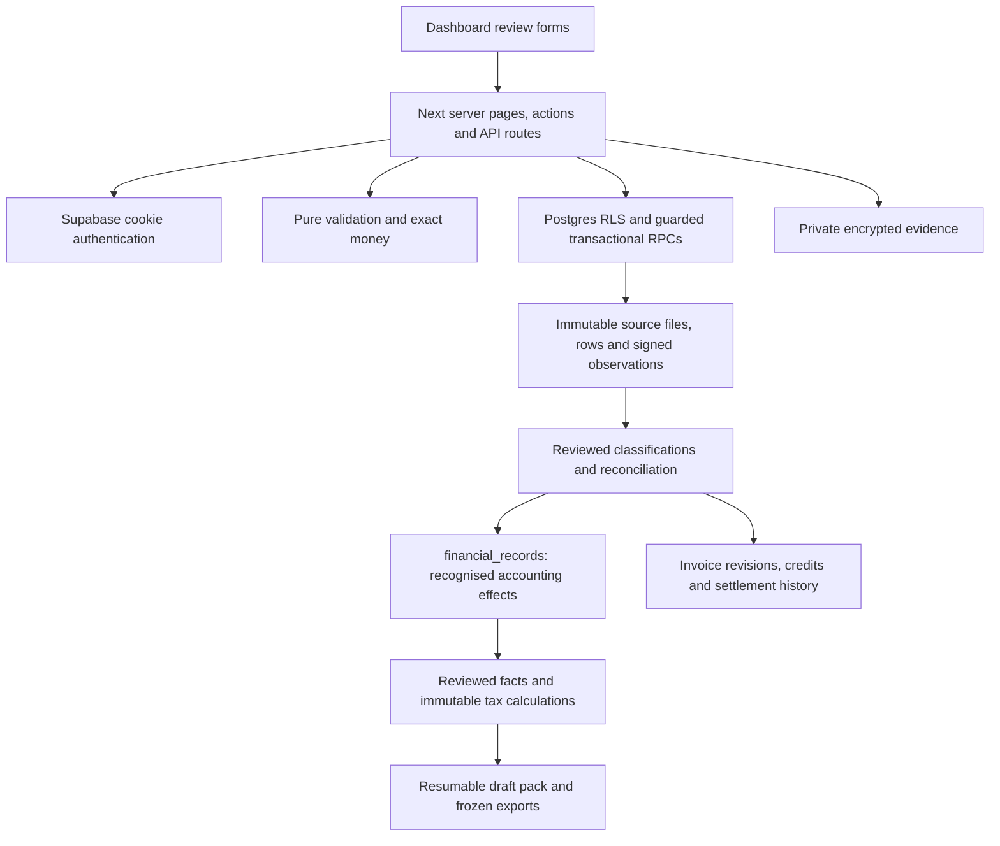

# Milestone 0 — repository audit and proposed implementation plan

Audit refreshed 18 October 2026 against the current working tree. **For user plan review: no application code, dependency, configuration or migration was changed or applied by this audit.** This document supersedes the earlier M0 snapshot for current-state decisions. Historical implementation notes remain historical evidence, not deployment certification.

## Lead engineer recommendation

Extend the existing Next.js/Supabase app. Keep `financial_records` as recognised accounting, with immutable source observations and reviewed decisions feeding it. Reuse the substantial local imports, reconciliation, merchant memory, tax calculation and draft filing work. A framework rewrite or parallel transaction ledger is unwarranted.

The first delivery should certify the existing Starling import → human classification → evidence-linked export flow. **No new tables are required for that slice.** Before implementation, select a reviewable release baseline and confirm this plan; the current dirty tree includes far more functionality than the tracked baseline.

## 1. Baseline and architecture

- Actual branch `claude/vibecount-ai-agents`, HEAD `5cb31c6`. The Phase 3 branch in `AGENTS.md` is stale.
- Inspection snapshot: 44 modified tracked files and 606 untracked files; **78 migrations: 25 tracked, 53 untracked**, with unique ordered timestamp prefixes. These counts describe local files, not hosted state.
- Current package stack: Next.js 16.4.2 App Router, React 19.2.4, TypeScript, Tailwind 4, Supabase SSR/Auth/Postgres/Storage. Existing integrations include Resend, PostHog and AI/voice providers.
- Tracked baseline already contains invoices, clients, PDF storage/download, reminders, quotes, proposals, contracts, projects, records/categories, older CSV/bank-statement review and an earlier tax estimator.
- The newer `app/dashboard/{imports,reconciliation,finance}`, `lib/{fx,tax,finance}` and source-ledger modules are untracked local extensions. Presence in the checkout does not establish release acceptance or deployment.
- Existing MCP/session code coexists with instructions parking Phase 4. Preserve it, isolate it from the release and do not extend it for this handover.
- `vercel.ts` schedules `/api/reminders/due` daily at 09:00 UTC. Hosted schedules, runtime, secrets and migration state were not inspected.



`proxy.ts` → `lib/supabase/middleware.ts` refreshes sessions and redirects dashboard requests. Dashboard layout and newer server actions/pages use `auth.getUser()`. APIs enforce authorization individually. `lib/supabase/admin.ts` supplies service-role access, so each privileged path must explicitly validate ownership; middleware and RLS alone cannot establish that boundary.

Newer modules separate pure domain validation from server-only stores, bounded browser projections and transactional SQL. Older direct CRUD remains; assess each affected write rather than replacing the architecture wholesale. Review confirmations must bind exact current inputs, while retained completed requests recover without repeating a financial effect.

## 2. Feature inventory and reuse

| Requirement | Existing implementation to reuse | Remaining proof or gap |
| --- | --- | --- |
| FR1 import and source preservation | `app/dashboard/imports`; `lib/records/source-{csv,store,persistence,crypto}.ts`; internal `source-csv-v2.ts`; document intake/store/recovery | Representative Starling/Nationwide/Amex format certification, hosted Storage/auth journey, readable document evidence and retention/access lifecycle; V2 foreign parser is not activated ingestion |
| FR2 reconciliation | `lib/records/{allocations,transfers,refunds,refund-splits,duplicates,match-proposals,import-reversal}.ts`; invoice credits/refund assignments; `lib/fx`; private bank valuations and raw source coverage | Full authenticated acceptance, release review of current FX activation; foreign admission/reviewed posting and coverage integration; fees and cross-currency credits/refunds |
| FR3 decisions/memory | `merchant-memory.ts`, `merchant-rollover.ts`, classification histories, scoped rule versions, override/undo and review queue | Materiality, recurring spend, evidence, bulk and keyboard journey acceptance; rule suggestions must remain human reviewed |
| FR4 tax engine | `lib/tax/{facts,scope,rules,calculation,snapshot}.ts`; immutable inputs and trace | Independent annual treatment review, complete historic evidence and explicit unsupported-case handling |
| FR5 guided assessment | `app/dashboard/tax-prep/filing-pack`; `lib/tax/{filing-pack,filing-server,form-mapping}.ts` | Independent annual box mapping, complete historic wizard/resume/invalidation/completeness journey |
| FR6 outputs | Frozen seven-artifact packs, reconciliation V4, source manifest V3, keyset paging and CSV protection | Independent source tie-out, large-artifact delivery, coordinated database/object/key recovery |
| FR7 ongoing OS | `lib/finance`, reviewed planning/deadline snapshots and finance pages | Representative forecasts, broader supported scenarios, operational acceptance; certify after P0 foundations |

Reuse tracked `DashboardShell`, `AccessibilityProvider`, `GlossaryProvider`, `ExplainTerm` and `ReadAloudButton`. Reuse semantic controls, stable test IDs, explicit figures/words, confirmation resets and immutable request review patterns from newer forms. Avoid a new UI framework.

Reuse `lib/money.ts` for exact pence/apportionment, UK tax-period helpers, signed accounting-effect helpers, `export-pages.ts`, consistency stamps and versioned snapshot serializers. Matching a receipt to an invoice must create no second income posting.

### Current FX status: important documentation correction

Existing migrations already implement sourced external invoice capture, conversion lots, dimensioned settlement history, full-lot reversal, shared native/FX receipt capacity, complete retained portion review, refund dependency contexts and source/filing provenance. Do not propose these as missing tables or features.

The earlier M0 and latest completed progress checkpoint described disabled FX financial saves. The actual working tree now also includes **`20261019080000_reviewed_fx_requests.sql`**, `lib/fx/reviewed-request*.ts`, FX server actions and `/dashboard/reconciliation/fx/requests`:

- Preparation freezes a durable owner-scoped read-back without financial effects.
- A separate final human confirmation can invoke authenticated `commit_fx_reviewed_request`.
- The underlying allocation/reversal cores remain private; the narrow SECURITY DEFINER wrapper invokes them.
- Cancellation, full-intent proof freshness, one unresolved owner request and exact completed-request recovery are implemented locally.

Thus the current tree contains an authenticated financial entry point through the reviewed wrapper. It is inaccurate to say all FX approval entry points remain inaccessible. Earlier focused local SQL/parser checks passed, but neither the entire activation journey nor hosted grants are certified here. Treat this local work as a release-review item, not a deployed milestone.

### Foreign bank sources: existing prerequisites and remaining boundary

`source-csv-v2.ts` preserves exact original units and currency exponents. Migration `20261019090000_private_bank_valuations.sql` already adds immutable original-unit fields and private valuation families, requests and revisions. Valuations have no accounting effect. Existing account/observation GBP constraints and non-null pence still prevent live foreign admission; application/service roles cannot execute private valuation writers.

Migration `20261019100000_bank_source_coverage.sql`, `bank-source-coverage.ts` and `BankSourceCoverage.tsx` add bounded owner-wide source coverage, original/valuation dimensions, native decision/posting guards and account-currency protection. Current import, merchant and tax-fact controls withhold unsupported native forms. These are local prerequisites, not a completed foreign workflow.

Two further local migrations already implement consumer containment:

- `20261019110000_operational_bank_coverage.sql`: operational financial-review V2, independent unsupported/unavailable year and quarter counts, aggregate provider summaries and dependency freezes. V1 replay is retained.
- `20261019120000_tax_bank_source_coverage.sql`: tax input V3, filing input V4 and bundle V5. Complete bank context is bound to calculation and step review; unsupported connected/cash-year sources withhold totals and completeness. Exact source identity, duplicate observation and omitted native-source checks protect the current contracts. Frozen ledger/trace/manifest artifacts retain original-unit and valuation context separately from recognised GBP effects. Historical versions remain explicit replay paths.

These are existing local implementations requiring acceptance, not completed foreign-account support. Migration `20261019130000_finance_bank_source_coverage.sql` also adds finance V3 with complete owner-wide bank/account coverage and independent cash/drawings withholding around unchanged manual scenarios; historical V1/V2 replay remains. Migration `20261019140000_native_bank_event_scope.sql` adds native event/duplicate/import source guards while preserving current function identity and historical recovery.

The current tree additionally contains direct matching/transfer/refund/duplicate choice safeguards in `native-choice.ts`, `native-choice-store.ts`, `BankChoiceReadback.tsx` and their page callers. They compare raw source identity, retain original-currency read-back, withhold unsupported native controls and check complete duplicate cohorts and pair endpoints. Their page tests failed during M0; the subsequent verified [direct-reader checkpoint](native-choice-readers.md) resolves the fixture contract failures and records full increment verification. Remaining work includes connected-graph reader containment, standalone source/reconciliation foreign-bank export semantics, guarded foreign registration, verified source bytes, human valuation review, separately confirmed classification/posting, and correction/reversal. Source metadata existence does not prove readable evidence; the currency-blocking helper must not become a completeness predicate. Invoice settlement lots cannot substitute for bank-source valuation. Keep foreign admission closed until these consumers and writes are proven together.

## 3. Existing data model and proposed database changes

| Handover logical noun | Actual existing model | Proposed decision |
| --- | --- | --- |
| Accounts/imports/transactions | `financial_accounts`, `record_imports`, `record_source_files`, `source_rows`, `bank_transactions`, upload attempts | Reuse; keep signed observations separate from recognised accounting |
| Recognised ledger | `financial_records` with magnitude, type and `effect_sign` | Retain unified model; exact decimal-to-pence conversion, no binary float calculations |
| Classifications and audit | `classification_decisions`, financial change history and specialised immutable request/event histories | Reuse; no duplicate generic classifications/audit model |
| Invoice/payment/evidence | Canonical invoices, immutable revisions, settlements, credits, refund assignments, evidence documents and reviewed source facts | Extend existing links only; retain native GBP contracts and original-currency dimensions |
| Merchant memory | Rule families/versions/applications, overrides, undo and rollover ancestry | Reuse scope, precedence, author and effective dates |
| Tax and filing | Profiles/fact revisions, scope attestations, rulesets, immutable calculations, mappings, step reviews and draft packs | New versions for supported changes; preserve historical replay and artifact bytes |
| Finance | Versioned plan/deadline rules, snapshots and source references | Keep actual cash, forecast reserve and inaccessible pension assets separate |

**Proposed change packages; no new SQL is authored in M0:**

1. **Baseline certification first.** Inventory the chosen existing migration chain and actual hosted grants/buckets/key references. Current 53 untracked SQL files are existing local work requiring review, not instructions to apply them all.
2. **Complete foreign-source consumers and workflow.** Reuse existing private original-unit/GBP valuation persistence and raw-source coverage. Certify existing operational V2 and tax V3/filing V4 coverage, certify the new finance V3 coverage contract while preserving old snapshots and retry behavior; complete standalone source/reconciliation exports before guarded admission and reviewed posting. Certify the implemented native event/duplicate/import guards and complete their current choice/connected-graph reader surfaces; generic posting triggers alone are insufficient. Design fees and cross-currency credits/refunds separately. Specify source, date, rate/recipe, reversal and tax/export treatment before further schema changes; do not duplicate valuation tables or infer GBP from invoice original units.
3. **Evidence access and lifecycle.** Add only missing append-only access history and reviewed retention/deletion transitions. Preserve source/key ancestry needed for recovery. Database backup alone is insufficient.
4. **Durable communications.** Add reviewed delivery request/attempt/outcome ancestry around current invoice/reminder flows, bound to recipient, content, invoice revision and provider identity. Recover uncertain outcomes without blindly resending.
5. **Tax/form extensions.** Add sourced year-specific rules or mapping versions only after treatment review. Preserve old snapshots; changed inputs invalidate current review. Unsupported treatment remains unresolved rather than defaulting to zero.

### Migration strategy

Select release scope → inspect deployed predecessor → rehearse chosen ordered chain with representative legacy rows → compare preserved outputs/grants/function identities → stage schema/application compatibility → validate hosted access → release small reversible increments.

Use additive/backfill/validate migrations where practical. Preserve public function identities and dependent views when wrapping existing functions. Use owner-composite references, explicit RPC/direct-write grants, safe search paths and transactional stale-review/capacity checks. Rehearse rollback before financial writes; immutable financial history requires forward repair rather than destructive rollback after use. Never fabricate hashes or provenance for legacy rows. Rehearse database, retained objects and historical keys together before production.

## 4. Prioritised M0–M5 backlog

Remaining-work estimates are provisional one-engineer days including focused tests, migration notes and synthetic demos. They exclude access delays, independent specialist review and unexpected hosted drift; these are issue packages to split into small reviewable changes.

| Issue | Priority / dependencies | Delivery and acceptance | Days |
| --- | --- | --- | --- |
| M0.1 release baseline | P0, first | Choose release base; inventory dirty work; isolate parked Phase 4; resolve current failing page tests and produce reviewable migration/release manifest | 1–2 |
| M0.2 security/deployment baseline | P0, M0.1 | Record hosted migrations, grants, RLS, private buckets and key references; disposition dependency findings; recovery rehearsal plan | 1–3 |
| M1.1 certify Starling slice | P0, M0.1–2 | Same import adds zero observations/effects; explicit reviewed posting; source-linked export and two-owner isolation | 2–3 |
| M1.2 provider/evidence acceptance | P1, M1.1 | Representative Nationwide/Amex variants, failed upload recovery, source access/privacy and coordinated restore proof | 3–5 |
| M2.1 certify GBP reconciliation | P0, M1.1 | £250/£275/£1,500 count once; partial/combined settlement; transfers/card repayments add no turnover/expense; refunds/credits/reversal preserve audit | 4–8 |
| M2.2 certify current FX work | P1, M2.1 | Review existing capture/lot/portion/proof/wrapper flow; final read-back, exact retries, zero-cash portions, independent capacities, source/export/filing parity; no duplicate income | 3–6 |
| M2.3 complete currency treatment | P1, M2.2; evidence/treatment decision | Certify existing private valuation/coverage; finish versioned consumers, guarded admission and reviewed posting/correction; separately design fees and cross-currency credits/refunds; unsupported cases stay blocked | 5–9 |
| M2.4 durable communications | P1, stable invoice/revision contracts | Current recipient/content requires confirmation; provider uncertainty cannot trigger duplicate delivery | 2–4 |
| M3.1 certify decisions/memory | P1, M1 and stable M2 | Scoped merchant rule reuse/expiry/override; recurring spend/materiality; unfamiliar £700 item surfaces; bulk/keyboard/undo remain reviewed | 2–4 |
| M4.1 annual tax acceptance | P0, M1–M3 and complete reviewed facts | Independent rules review; PAYE, NI, pension, vehicle-method, payment-credit/POA and 5/6 April cases; missing inputs block; deterministic trace | 4–7 |
| M5.1 guided draft pack | P0, M4.1 and annual mapping review | Resume/invalidation/completeness; all seven artifacts tie to evidence; no ready claim with material unknowns; prominent draft/not-submitted copy | 5–9 |

Planning range: **32–60 engineering days** for the packages above, to re-estimate after baseline/provider rehearsal. P0 release scope may defer broader FX and communications packages only if those unsupported paths remain explicitly unavailable. M6 forecasting and advanced P2 work should follow certified ledger/tax foundations; do not rebuild their existing local modules.

## 5. Smallest vertical slice and acceptance

**One GBP Starling CSV → mapping/date/sign preview → encrypted immutable file/rows → idempotent import → explicit human classification → linked recognised record → source-linked ledger CSV and manifest.**

Existing path: `ImportWizard.tsx` → `imports/actions.ts` → `source-{csv,store,persistence,crypto}.ts` → `TransactionReview.tsx` / `review_bank_transaction` → `financial_records` → `app/api/imports/[importId]/export/route.ts`. Use `fixtures/synthetic-starling.csv` for development; require a representative anonymised export for provider acceptance.

Acceptance rehearsal:

1. Reimport the same file/account, including concurrent attempts: zero extra observations or recognised effects. Keep genuine repeated purchases distinct; overlapping different files remain reviewable.
2. Every row retains file/row hash, original row number, parser version and account. Ambiguous dates/signs/precision/currency hard-stop. 5 and 6 April belong to different tax years.
3. Explicit 30% Mixed review of £630.29 reads back £189.09 candidate business amount; tax eligibility and vehicle method remain separate decisions. Personal Airbnb stays excluded.
4. Figures and words, exact selected version and explicit confirmation precede posting. Changed fields reset confirmation; stale approval fails; a late SQL error rolls back record and audit together.
5. Unknown, duplicate and transfer observations create no claim. Matching the £1,500 receipt creates no additional income.
6. Export totals tie to source/decision/record; excluded rows remain visible; complete paging and consistency checks reject drift; CSV formula protection does not alter originals.
7. Owner A cannot read/link owner B's rows or objects through UI, RPC or hosted Storage; anonymous access fails. Raw bank sources never enter AI or agent projections.
8. Demonstrate signed-in keyboard import/review/reimport/export/reversal and coordinated recovery in a controlled environment. Local SQL/component tests alone are insufficient.

## 6. Security/privacy and tax risks

- **Release integrity:** large untracked implementation and parked agent code need deliberate isolation. Neither filenames nor earlier progress notes establish deployed state.
- **Financial authorization:** RLS is not a human confirmation gate. Review legacy direct CRUD and the new authenticated FX wrapper; service-role helpers must enforce owned scope. Before foreign admission, audit event-only settlements, refunds, duplicates and reversal writers across complete raw sources; generic posting triggers are insufficient. Test stale reviews, source/valuation/approval races, dependency-blocked corrections, exact recovery after source loss and native byte/function/grant compatibility.
- **Evidence privacy:** private encrypted source/document buckets and server ingestion already exist. Pattern bank-number redaction is not complete minimisation. Audit AI/voice/batch-provider consent, logging and data egress per route. `app/api/review/suggest` has explicit per-request consent; that does not certify every older AI route. PostHog autocapture/session recording are disabled in current code.
- **Recovery/retention:** current account export explicitly omits source objects, keys and substantial histories; it is a partial export, not a restorable backup. Demonstrate database/object/key recovery and reviewed deletion/retention semantics.
- **Dependencies:** fresh npm audit reports five high affected entries and zero critical, all in the braces → micromatch → fast-glob → Next ESLint tooling chain. This is not five demonstrated production exploits. The suggested automatic fix crosses major Next ESLint versions; review compatibility rather than force-fix. Current CI gates critical severity, so high findings remain a disposition item.
- **Operations:** reconcile cron expectations with UTC configuration. Before deployment work, upgrade the session-reported outdated Vercel CLI using `npm i -g vercel@latest`; no tooling upgrade is part of M0.
- **Tax scope:** `lib/tax/rules.ts` and `form-mapping.ts` explicitly mark independent tax review pending. This audit inventories code; it does not validate current HMRC rates, eligibility or form mapping. Require current official-source verification and named independent review before acceptance. Missing is not zero; unsupported tax treatment must block completion.
- **Historic facts:** do not hard-code the handover's PAYE, redundancy, pensions or partial expense totals as production facts. Obtain reviewed source evidence and completeness. Pension savings are not accessible cash; invoices, received cash, profit, actual reserves and forecasts remain distinct.
- **Claims:** draft worksheets and MTD-ready records do not establish HMRC filing, MTD recognition or accountant certification. No account connection, payment or filing is authorized by this audit.

## 7. Verification performed and its limits

Read `handover2.md`, project instructions, current code, package/CI/deployment configuration, prior design/progress notes and migration inventory. Two read-only research agents independently inspected architecture/reuse and schema/security, including the current bank coverage and event migrations. Only this audit document was edited during this refresh; existing application changes were left intact.

Fresh focused command:

```sh
npx tsx --test --test-concurrency=2 lib/money.test.ts lib/records/source-csv.test.ts lib/records/source-crypto.test.ts lib/records/export-csv.test.ts lib/database/imports.test.ts lib/records/bank-source-coverage.test.ts
```

**22 tests passed; zero failed, cancelled or skipped.** Actual ordered SQL replay includes all 78 local migrations and legacy-row upgrade checks. Coverage includes import retry/rollback/stale/foreign denial, encrypted evidence, exact mixed-use arithmetic, CSV injection, and strict bank-coverage counts/representation validation. Fresh log: `/tmp/vibecount-m0-foundation-audit.log`. Earlier results remain historical evidence.

Additional fresh current-reader check:

```sh
npx tsx --test --test-concurrency=2 lib/records/native-choice.test.ts lib/records/native-choice-pages.test.ts lib/records/match-data.test.ts lib/records/match-page.test.ts lib/fx/refund-dependency-route.test.ts
```

**7 passed / 3 failed**. All three failures are in `native-choice-pages.test.ts`: expected native transfer/duplicate/reversal controls are replaced by unavailable-evidence states. The fixture returns account IDs in insertion order (20, 21, 23, 22), despite the production reader's explicit ascending-ID order and strict paging contract. This is a concrete likely fixture cause, not proof that production is broken or that the implementation is otherwise correct. Repair the fixture contract, rerun these checks, then investigate any remaining failure before accepting this increment. No repair was made during this audit. Log: `/tmp/vibecount-m0-current-readers.log`.

Fresh standalone `npx tsc --noEmit` passed. Fresh `npm audit --json`: **5 high / 0 critical**; report `/tmp/vibecount-m0-current-audit.json`. No dependency changes were made. This audit did not freshly run the complete automated suite, all **17 configured browser scripts**, lint or production build. The latest completed prior checkpoint reports 722 automated tests, 16 browser suites and a clean build; subsequent direct-choice work is not covered by that checkpoint. Do not combine retained passing results with today's failing current-tree check into a release certification.

The earlier audit flagged original-unit display coercion in `TransactionReview.tsx`. Current code already uses strict `bankOriginalMinor` validation; the focused regression now passes. Do not reschedule that repaired issue. Native financial forms remain withheld for unsupported sources.

The minimal Supabase bootstrap in `lib/database/test-schema.ts` approximates hosted Auth/Storage. Local SQL tests do not prove hosted JWT, PostgREST or Storage HTTP policy behavior. No hosted migration, deployment, provider call, real financial approval, account connection, send, payment or filing occurred.

## 8. Decisions and genuinely missing inputs

Nothing blocks this repository audit. **Before implementation, confirm the release baseline/scope:** use the current dirty checkout after reviewing/isolation of local additions, or another explicitly selected base. My recommendation is to preserve and certify the local work in small increments rather than start from scratch.

Later acceptance requires representative anonymised provider formats, controlled hosted migration/grant/Storage metadata, complete reviewed historic source facts and a named independent annual tax/form reviewer. These become prerequisites at the relevant gates, not reasons to invent data or duplicate infrastructure now.

Implementation awaits user review of this plan, as the supplied workflow instructions require. No application implementation begins as part of M0.


Subsequent implementation evidence: [direct native choice readers](native-choice-readers.md) records 728 automated tests, all 17 browser suites and clean build/type/lint/smoke checks. The M0 failing-run table above remains the historical audit result, not an unresolved current failure. No new migration was introduced.


Subsequent database checkpoint: [connected source review SQL](native-connected-readers.md) adds migration 79 (54 untracked additions) and passes 740 automated tests plus all 17 browser suites. Current pages/actions still use V2 pending complete V3 integration; these read-only prerequisites do not enable foreign ingestion or posting.
